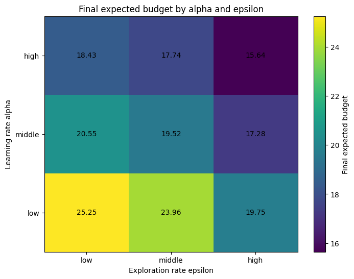
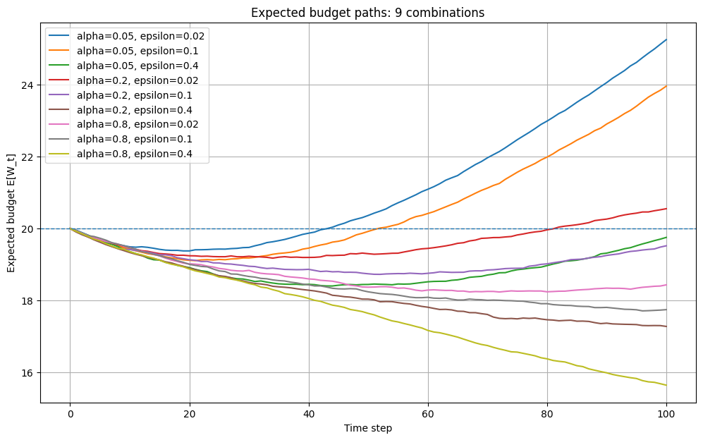
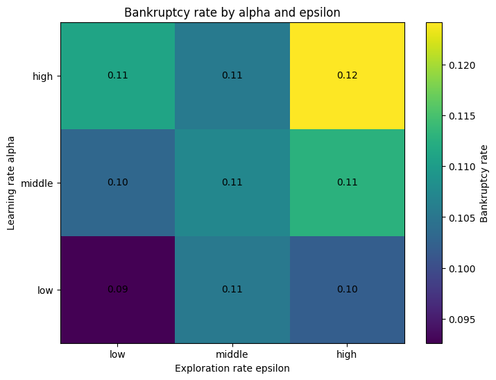
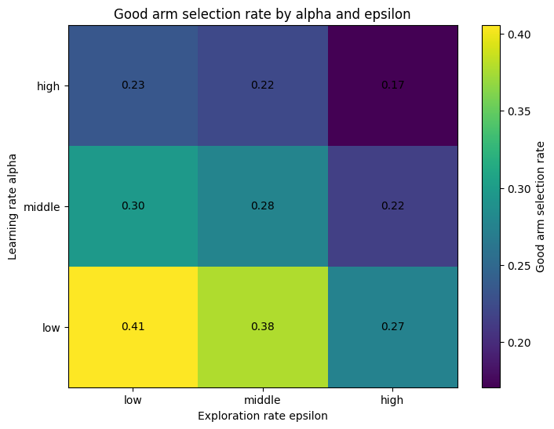

# Multi-Armed Bandit: ε-greedy with a Finite Budget

## 概要

授業「実践的機械学習II」で作成した、多腕バンディット問題のPythonシミュレーションを整理したものです。未知の報酬確率を持つ10本の腕の中から、報酬を観測しながら選択肢を学習する**ε-greedy法**を実装し、学習率 `alpha` と探索率 `epsilon` の設定が結果に与える影響を比較しました。

これは**状態遷移のない多腕バンディット問題**であり、DQN・PPO・Q-learningなどの深層／状態依存強化学習ではありません。

## 問題設定

- 腕の数：10本。各試行で1本を「良い腕」としてランダムに配置する。
- 良い腕の成功確率：0.65。それ以外の9本：0.44。
- 報酬：成功 `+1`、失敗 `-1`。
- 初期予算：20。予算が0になると破産し、その試行を終了する。
- 1試行の最大ステップ数：100。1条件につき5,000試行。
- 行動価値 `Q(a)` は0から開始し、ε-greedyで選択・逐次更新する。

### 行動選択・学習則

- 確率 `1−ε` で `argmax_a Q(a)` を選択する（同点は微小乱数で解消）。
- 確率 `ε` で10本から一様ランダムに選択する（最良推定の腕も含む）。
- 選んだ腕の価値を更新する：

\[
Q_{t+1}(a_t)=Q_t(a_t)+\alpha\bigl(R_t-Q_t(a_t)\bigr).
\]

`alpha` は新しい報酬を推定値に反映する強さ、`epsilon` は探索と活用のバランスを決めます。

## 実装

- [`bandit.py`](bandit.py)：NumPyの配列演算で5,000試行をまとめて処理するシミュレーション。シード、破産判定、行動価値更新、指標集計を実装。
- [`experiment.py`](experiment.py)：9条件を実行してCSV・グラフ5点を作成。
- [`tests/test_bandit.py`](tests/test_bandit.py)：再現性、会計関係、常に成功／失敗する境界条件、無効入力をテスト。
- [`notebooks/original_course_simulation.ipynb`](notebooks/original_course_simulation.ipynb)：授業時のコード構造を残したノートブック。公開用にセル出力と環境メタデータを削除。

```bash
# リポジトリのルートから
python -m pip install -r requirements-dev.txt
python -m pytest -q
python multi-armed-bandit/experiment.py
```

## 実験方法

`alpha = {0.05, 0.20, 0.80}`、`epsilon = {0.02, 0.10, 0.40}` の9条件を比較しました。各条件について5,000試行を行い、次の指標を記録しています。

- **最終予算期待値**：100ステップ終了時点（破産した試行は0）の予算平均。
- **平均累積報酬**：1試行で獲得した報酬の平均。最終予算期待値−初期予算と一致。
- **破産率**：予算が0になった試行の割合。
- **平均試行回数**：破産による途中終了を含めた平均行動回数。
- **良い腕の選択率**：各試行の良い腕の選択比率を計算した後、その平均を算出（試行回数でプールしない）。

元の授業実験を再現するため、条件1～9で異なる固定乱数シード（`12345 + condition_index`）を使用しています。

## 結果

| 学習率 α | 探索率 ε | 最終予算期待値 | 破産率 | 良い腕の選択率 |
| ---: | ---: | ---: | ---: | ---: |
| 0.05 | 0.02 | 25.2536 | 9.26% | 40.57% |
| 0.05 | 0.10 | 23.9600 | 10.54% | 37.76% |
| 0.05 | 0.40 | 19.7536 | 10.20% | 27.48% |
| 0.20 | 0.02 | 20.5516 | 10.32% | 29.82% |
| 0.20 | 0.10 | 19.5204 | 10.72% | 27.63% |
| 0.20 | 0.40 | 17.2776 | 11.28% | 21.50% |
| 0.80 | 0.02 | 18.4332 | 11.10% | 23.42% |
| 0.80 | 0.10 | 17.7444 | 10.56% | 22.25% |
| 0.80 | 0.40 | 15.6440 | 12.42% | 17.07% |

全指標の厳密な値は [`results/summary.csv`](results/summary.csv) を参照してください。









### 観察

- 今回の9条件では `alpha=0.05, epsilon=0.02` が最終予算期待値最大（`25.2536`）。
- この条件における破産率は `9.26%`。
- 初期予算20を上回る条件もある一方、初期予算を下回る条件もありました。

### 解釈上の制約

この結果は**指定した確率・予算・試行回数・9条件**に限った観察であり、小さな `alpha` や `epsilon` が一般に最適という証拠ではありません。条件ごとに異なる乱数シードを使用しているため、比較には標本誤差が混在します。また、ランダム方策・既知の最適腕を選ぶ方策などの明示的ベースライン、複数シードの信頼区間、外部環境への汎化評価はまだ実施していません。

なお、現状の実験は「同じ環境条件に対するパラメータ比較」であり、論文の新規手法の提案や深層強化学習の実装ではありません。

## 今後の改善候補

1. 一様ランダム選択と、既知の最良腕を選ぶ方策をベースラインとして比較。
2. 複数シードにわたる平均・信頼区間を算出。
3. 環境報酬系列を共通化して、条件比較の乱数差を抑制。
4. UCB・Thompson Samplingと比較し、探索方策の違いを分析。

## 出典・制作経緯

2026年春学期の授業「実践的機械学習II」で作成したGoogle Colabノートブックを元に、公開用の構成整理、入力検証、テスト、実験再現スクリプトを追加しました。これらの整理・ドキュメント作成にはAI支援を利用しています。授業配布資料や第三者の著作物は含めていません。授業の公開条件がある場合には、それを優先してください。